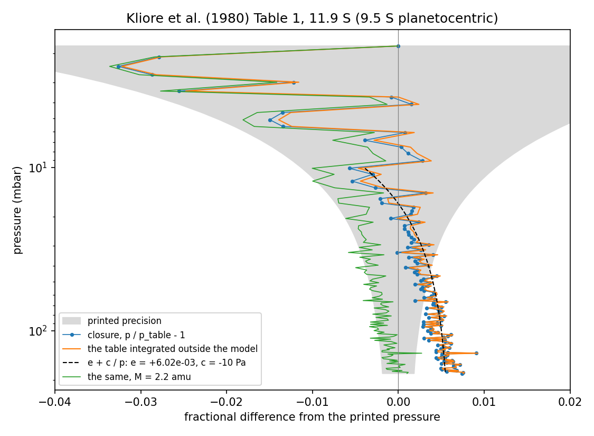

# REPORT 18, Step 1: Kliore et al. (1980) as a second registered profile

SPEC_18 v0.3, Step 1. 5 November 2026. For the author and the reviewing agent. `main` is at `6802bed`;
nothing is committed. Acceptance: `tests/step18_1/accept_step18_1.py`, output and `summary.json` in
`reports/step18_1/`. **6 of 6 pass**: the five of SPEC_18 §4 and one beyond the specification.

Pioneer 11's exit is 11.9 S planetographic (9.5 S planetocentric).

## 1. Result

- **Kliore is a working kind N with a closure run,** and `refrac` and `forward` are unchanged.
- **Lindal's answer is unchanged.** No registered file changed. His files rebuilt in a copy by the
  changed tools differ in no value.
- **The closure's drift is explained as a property of the source, up to one thing the table cannot
  settle.** Integrating Kliore's table outside the model reproduces it. It is a constant +0.6 percent
  in the product M g plus an offset of about -10 Pa from the top of the profile. The table fixes only
  the product, so it cannot say whether the 0.6 percent is his gravity or his molecular mass. The mass
  reading fits strikingly well (§5), but it is an inference: I found neither number in either Kliore
  paper's text.

## 2. What was built

| Item | Where |
|---|---|
| Shared kind D and manifest writers | `src/casspian/tools/profile_inputs.py` (new) |
| Lindal's stage two, reduced to kind T | `src/casspian/tools/lindal/build_inputs.py` |
| Lindal's ammonia fill and its text | `src/casspian/tools/lindal/ammonia.py` (new) |
| General composition tool | `src/casspian/tools/composition/build_composition.py` |
| Kliore's stages one and two | `src/casspian/tools/kliore/` (new) |
| Scalars, raw bundle, build file, kinds T, C, D, G, R, W, manifest, kind N | `occul_data/kliore1980/` |
| Closure run | `forward/kliore1980_closure/` |
| Build order | `docs/RUNBOOK.md` |

The §5 rulings are applied as written. No `inserted_level` variable exists; the level is identified by
its pressure, with comments.

**Three points for the reviewer:**
- **The closure run's inputs and product are not registered.** `.gitignore` excepts only
  `lindal_closure` and `lindal_transfer`, and SPEC_18 §4 asks for commits under `occul_data/kliore1980/`
  only. So only its two control files would be committed; the inputs and product rebuild from them. If
  you want it registered like Lindal's closure, it needs two `.gitignore` lines.
- **The Kliore products are stamped `-dirty`** because they were built before any commit. They need
  rebuilding at the acceptance commit, as earlier steps did.
- **Entry points:** `casspian-kliore-raw` and `casspian-kliore-inputs` are in `pyproject.toml`, but I did
  not reinstall the package. I ran the tools with `python -m`, so the two commands in the runbook need
  `pip install -e .` first.

## 3. Checks 1 to 3 and 6

**Check 1, Lindal's answer.** `git status` of `occul_data/lindal` and `forward/lindal_*` is clean. The
old files in the copy were deleted first, so the rebuild could not simply keep them.

| Rebuilt | Variables | Differ in value | Attributes written that differ |
|---|---|---|---|
| `lindal_composition.nc` | 15 | 0 | 0 |
| `lindal_thermo.nc` | 7 | 0 | 0 |
| `lindal_geodesy.nc` | 8 | 0 | 0 |
| kind C of all 23 runs | 345 | 0 | 0 |
| `lindal_reduction.toml` | | byte-equal | |

The three `occul_data` files also carry 3, 14 and 2 older globals the tools stopped writing at SPEC_R1.
Those are counted and not compared. With this result, no other suite was rerun (SPEC_18 §0).

**Check 2, refractivity.** RMS 0.031 n-units, largest +0.086 at 99.6 mbar, mean +0.006, against the
table's 0.05 half step; 114 of 128 levels are inside it. The inserted 100 mbar level is 37.82 n-units,
between the table's 37.6 and 38.4.

**Check 3, radius.** Kind N minus Kliore is **+1.27 km with no spread** (range under 1 mm), so ruling 2
keeps his spacing exactly. SPEC_16's +9.2 km is a different quantity: the radius delivered under the
Sanchez-Lavega and IRIS wind, not this reduction's own geoid under Lindal's wind. The 8 km between them
is about what SPEC_17 found at the southern points, but I did not test that as the cause.

**Check 6, beyond the specification.**
- Kinds D, G, R and W equal Lindal's in every value, which also confirms the transcribed surfaces
  (ruling 4).
- None of Kliore's files records a Lindal file among its inputs.
- The label -11.89344 deg returns `phi_c` -9.50000008 deg.
- There are 129 levels, 128 of them tabulated; the inserted level is 89.75 K.
- Kind T's uncertainties are NaN, with Kliore's ranges on 26 rows of the raw bundle.

## 4. Check 4, the closure

The envelope is computed in the acceptance script, and F6 is unchanged: the level's printed pressure
(5 Pa), the boundary's (5 Pa, since every level starts from it), and the printed radius (50 m) over a
scale height.

| Bin (tabulated pressure) | Levels | Max abs residual | Mean | Max abs dT | Envelope (median) | Inside |
|---|---|---|---|---|---|---|
| above 2 mbar | 1 | 0 (the boundary) | 0 | 0 | 5.7e-2 | 1 |
| 2 to 10 mbar | 15 | 3.26e-2 | -1.11e-2 | 3.93 K | 2.3e-2 | 15 |
| 10 to 100 mbar | 71 | 5.69e-3 | +2.42e-3 | 0.53 K | 3.4e-3 | 40 |
| below 100 mbar, without the bottom row | 41 | 9.07e-3 | +5.45e-3 | 0.85 K | 2.0e-3 | 0 |

- Bottom row, 182.2 mbar: +7.40e-3. Mean below 10 mbar: +3.56e-3.
- **Pressure identity:** T and p residuals agree to 4.4e-16.
- **56 of 129 levels are inside the envelope.** Above 10 mbar the closure is within what the table
  prints. Below 100 mbar no level is, and that is the drift of check 5.
- F6 draws a narrower envelope than this one, because it reads the height column's precision from
  derived values, as the pre-execution report said it would.

## 5. Check 5, the drift

Kliore's table was integrated outside the model, with our gravity at 9.5 S (wind included) and his 90/10
composition. Means of `p / p_table - 1`:

| Integration | 2-10 mbar | 10-30 | 30-100 | 100-182 | bottom |
|---|---|---|---|---|---|
| **The closure product** | -1.11e-2 | +4.1e-5 | +3.35e-3 | +5.54e-3 | +7.40e-3 |
| Density form, `dp = rho g dr`, ours | -1.03e-2 | +8.2e-4 | +3.73e-3 | +5.74e-3 | +7.57e-3 |
| Density form, M = 2.2 amu | -1.39e-2 | -5.1e-3 | -2.66e-3 | -7.8e-4 | +1.01e-3 |
| Density form, no wind | -4.3e-3 | +1.06e-2 | +1.42e-2 | +1.65e-2 | +1.83e-2 |
| Density form, no wind, M = 2.2 amu | -8.0e-3 | +4.6e-3 | +7.8e-3 | +9.9e-3 | +1.17e-2 |
| ln p from 10 mbar, ours | -7.7e-4 | +4.9e-3 | +1.06e-2 | +1.65e-2 | +2.00e-2 |
| ln p from 10 mbar, M = 2.2 amu | +4.5e-3 | +7.3e-4 | -1.2e-3 | -9.4e-4 | +7.0e-4 |
| ln p from 1.8 mbar, ours | -2.59e-2 | -2.03e-2 | -1.49e-2 | -9.0e-3 | -5.6e-3 |

**What this shows:**

1. **It is not the model.** The density form uses none of the production code and reproduces the
   closure's bins to 8.4e-4.

2. **It is not really a drift.** From 10 mbar down the residual fits `r = e + c / p` with **e = +6.0e-3
   and c = -10.0 Pa** (closure: +5.9e-3, -11.1 Pa). The residual is a constant, and the offset from the
   top fades as pressure grows, which is what looked like a drift. With the fit removed, 108 of 112
   levels are inside the envelope.

3. **The constant is M g.** The table implies M g = 19.94 (g/mol times m/s2) against our 20.07, so ours
   is +0.63 percent higher, matching e independently.

4. **The table cannot split M from g.**
   - **As a gravity:** 9.004 m/s2 against our 9.061, with M = 2.2146 amu.
   - **As a mass:** 2.2007 amu with our gravity. That is very close to 2.2, which 0.9 x 2 + 0.1 x 4 gives
     with whole-number masses. With M = 2.2, the 100 to 182 mbar mean drops to -7.8e-4, and with the same
     -10 Pa offset removed, 110 of 112 levels are inside the envelope.

   I lean toward the mass reading, because it needs no fitted value, but it remains an inference. A
   search of both papers' extracted text (scanned, so a miss is possible) found no mean mass, no gravity
   value and no rotation period; they say only that the mass, harmonics and rotation rate were used.

5. **Our no-wind gravity does not fit,** at +1.72 percent in M g, and M = 2.2 does not rescue it
   (+9.9e-3). Kliore's effective gravity was therefore close to ours with the wind, or lower. How he got
   there, whether from a faster rotation rate or otherwise, is not settled, and I did not test it.

6. **The -10 Pa offset is only partly accounted for.** The boundary's printed half step is 5 Pa. The rest
   is presumably the rounded densities of the top layers, where pressure and refractivity are least
   precise, but I did not test that separately.

**The form matters.** SPEC_18 §4 describes integrating his temperatures, which is the ln p form. There the
same 0.6 percent grows with depth (+1.65e-2 from 10 mbar) because each level builds on the last, and
starting from 1.8 mbar carries that level's 2.8 percent rounding to every level. The density form is the
one that matches the closure, so I report both.

## 6. For the review

- **Is check 5's explanation enough to close Step 1?** The drift is shown to be the source's and to be a
  constant in M g, but M against g stays open. I recommend closing on it.
- **If Kliore becomes an anchor,** that 0.6 percent matters only if M = 2.2 is really what he used.
  Refractivity depends on T and p, not on M, but his printed T and p came from his integration. That
  belongs to the ruling on how Kliore becomes an anchor (ruling 3's "when Kliore becomes an anchor").
- **Not done:** no other suite was rerun, as SPEC_18 §0 directs, and nothing is committed.

**At acceptance:** the acceptance commit (tools, data files, `pyproject.toml`, runbook, test, this report
and its review, the pre-execution report, SPEC_18 v0.3, `STATE.md`), Kliore's products rebuilt clean at
that commit, the hash in `STATE.md`, then push. `docs/CASSPIAN_Wind_Estimation_Design_Note_2026-11-05.md`
is still untracked and not part of this unless you say so.
