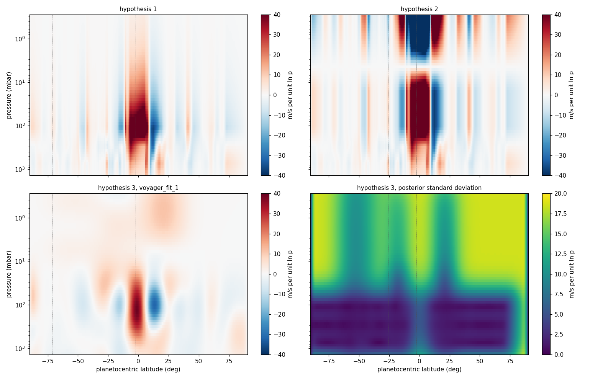
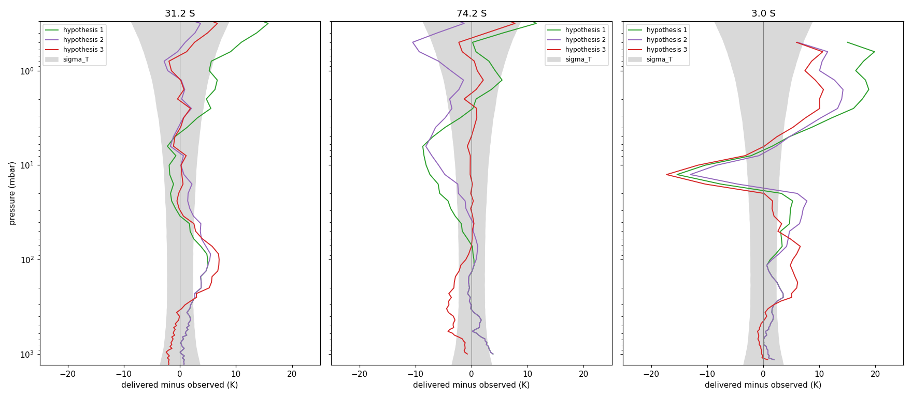
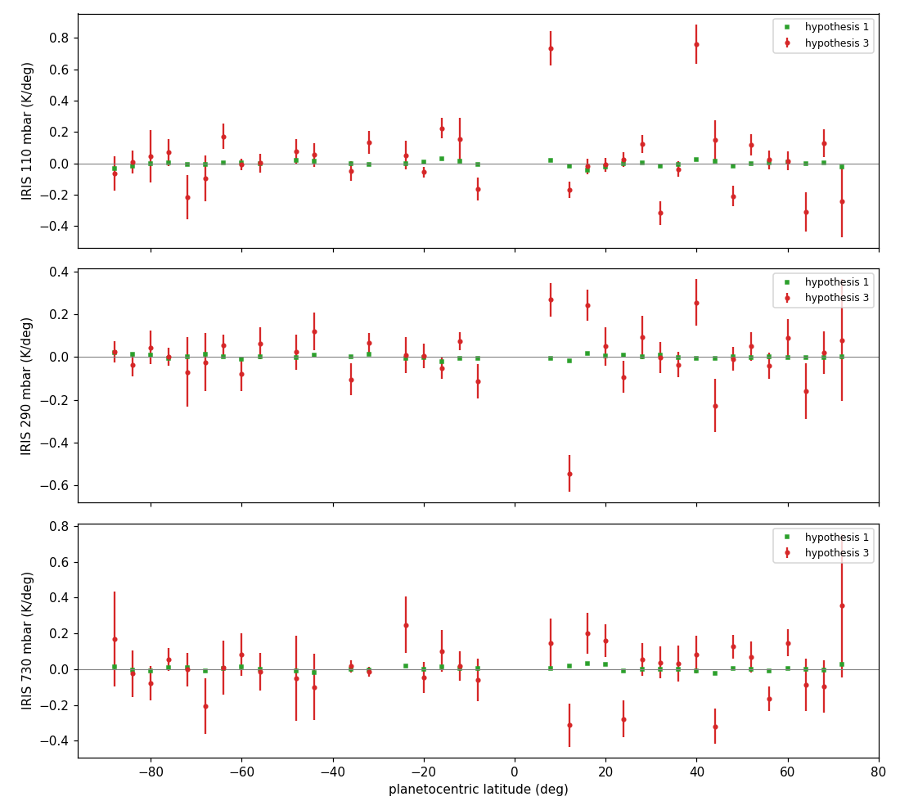

# REPORT 19, Step 1: the wind fit, and hypothesis 3 at the Voyager epoch

SPEC_19 v0.2, Step 1. 5 November 2026. For the author and the reviewing agent. Nothing is committed.
Acceptance: `tests/step19_1/accept_step19_1.py`, output `reports/step19_1/run.log` and `summary.json`.
**6 of 7 pass. Check 1, the synthetic test as specified, fails.** The script returns 1.

Latitudes are planetographic with planetocentric in parentheses. Where the fit's own planetocentric grid
is converted, I use the anchor's ratio of tangents, 1.24 (36.5 N, 30.8 N planetocentric).

## 1. Result

- **The tool works.** With the truth drawn from the prior, it recovers the shear within its posterior
  uncertainty and every group's misfit is near its expected value (check 1b). The fit converges in 3
  passes, and the gradient operator returns hypothesis 1's data to a fifth of the stated error.
- **Hypothesis 3 should not be adopted under the budget as ruled.** The 10 deg latitude correlation
  prevents the jets' structure, which §2 item 1 says it must not. The fit cuts the equatorial shear at
  110 mbar from +65 to +11 m/s per unit `ln p` at 6.2 N (5 N planetocentric). Its stated uncertainty there
  does not cover this.
- **At 110 mbar the fit does not land between IRIS and the radio.** It lands on IRIS's side: +6.97 K at
  31.2 S against +7.17 K from IRIS alone, with the radio at 0. The radio moves it by only 0.20 K.
- **I recommend a budget revision and a refit (§7).** That is the author's ruling. I changed no budget
  value; every alternative below is one linear solve on the final linearization, not a fit.

## 2. What was built

| Item | Where |
|---|---|
| State, prior, solver | `src/casspian/tools/wind/estimation/` `state.py`, `prior.py`, `solver.py` |
| Observation types | `radio.py`, `gradient.py` in the same package |
| Control, iteration, kind W | `driver.py`; command `casspian-wind-fit` in `pyproject.toml` |
| Control file with the budget | `fits/voyager_fit_1/voyager_fit_1.toml` |
| Wind | `fits/voyager_fit_1/voyager_fit_1_wind.nc` |
| Runs | `forward/lindal_voyager_fit_1`, `_74s`, `_03s`, only the wind changed from `lindal_iris_v_sl_ii_110*` |

The system has 777 unknowns and 289 rows: 65, 60 and 59 radio, 35 at each IRIS level.

**Departures and choices for the reviewer:**
1. **The path differs from the specification.** §3 names `tools/wind/fit.py`, but that is SPEC_01's accepted
   point-based fit, so I kept it and built a package beside it. The command is as specified.
2. **The radio correlation is exponential,** `exp(-|d ln p| / 0.5)`. §2 gives the length, not the form. I
   chose it for conditioning on 66 close levels, and §5 shows it has a cost.
3. **The prior acts on spline coefficients,** between Greville abscissae, so the point standard deviation
   comes out 18.5, not 20.
4. **Polar basis functions are dropped,** so the wind is exactly zero at the poles (37 latitude functions).
5. **First guess:** the projection of hypothesis 1 for the real fit, the prior mean for the synthetic ones.
   The prior mean stays zero in both. I did not rerun the real fit from the prior mean to compare.
6. **Leave-one-out and the systematic terms are linear,** on the final linearization.
7. **Beyond the specification:** check 1b, check 6, and the diagnostics in checks 2 and 3 (the path
   decomposition, the basis limit, the radio modes, the other budgets).
8. **Not yet done:** `pip install -e .`. The script calls the driver directly, so the command itself has
   not been run. The products are stamped `-dirty` and need rebuilding at the acceptance commit.

**For a ruling:** `fits/` is a new top-level directory. Its work directories are ignored, and I would
commit the control file and the wind file (1.1 MB), since the runs' inputs are ignored and rebuild from it.

## 3. Check 1: the synthetic test

| | truth hypothesis 1 (check 1) | truth drawn from the prior (check 1b) |
|---|---|---|
| Passes from the prior mean | 3 | 5 |
| RMS shear error / true RMS (m/s per unit `ln p`) | 5.55 / 8.36 | 12.58 / 17.14 |
| Within 1 sd, 2 sd | 83.6 %, 93.6 % | 73.4 %, 95.4 % |
| Where constrained: within 2 sd | 84.1 % | 99.9 % |
| Ratio 31.2 S, 74.2 S, 3.0 S | 0.96, 1.13, 0.73 | 0.87, 1.25, 0.64 |
| Ratio IRIS 110, 290, 730 mbar | **8.10, 2.09**, 1.49 | 1.13, 0.75, 1.08 |
| Ratio, all | 1.56 | 0.93 |
| Result | **FAIL** | PASS |

The bound is mine, my reading of "near its expected value": at least 90 percent within 2 sd, and every
group between 0.5 and 2. My first version looked only at the total and passed with IRIS 110 at 8.10, which
was not honest to the wording, so I tightened it. The failure stands.

**The failure is the prior, not the tool.** Hypothesis 1 lies on the basis, so the basis can hold it, and it
has narrow jets to about 65 m/s per unit `ln p` against a 10 deg correlation. A truth the prior considers very
unlikely gets pulled toward smoothness with an uncertainty that does not cover it (`synthetic_hypothesis_1.png`,
beyond 3 sd around 100 to 700 mbar). The same test under 5 deg brings IRIS to 3.30, 0.95 and 0.50.
These 5 deg values are one linear solve, not a fit. Check 1b is one draw, not an ensemble.

## 4. Check 2: hypothesis 3

Delivered minus observed (K):

| Target | Hypothesis | 730 | 290 | 110 | 30 | 10 | 4.5 | 1 mbar |
|---|---|---|---|---|---|---|---|---|
| 31.2 S | 1 | +0.40 | +2.32 | +5.00 | -0.51 | -1.90 | +0.10 | +5.24 |
| | 2 | +0.40 | +2.30 | +5.09 | +2.00 | +0.20 | -0.77 | -2.17 |
| | **3** | -1.34 | +1.56 | +6.97 | +0.12 | +0.22 | -0.43 | -1.50 |
| 74.2 S | 1 | +2.52 | +0.12 | +0.40 | -3.42 | -8.10 | -6.30 | +4.21 |
| | 2 | +2.52 | +0.11 | +0.50 | -0.74 | -5.88 | -7.26 | -3.70 |
| | **3** | -1.35 | -3.73 | -1.68 | +0.04 | -0.24 | -0.24 | +1.02 |
| 3.0 S | 1 | +0.08 | +2.21 | +0.76 | +4.77 | -10.30 | +6.84 | +16.48 |
| | 2 | +0.08 | +2.20 | +0.84 | +7.00 | -8.27 | +6.32 | +10.04 |
| | **3** | -0.72 | +2.44 | +4.89 | +1.58 | -11.60 | +4.09 | +7.43 |
| sigma_T | | 2.73 | 2.29 | 2.27 | 2.47 | 2.88 | 3.47 | 5.42 |

- **Above 30 mbar the fit improves,** most at 74.2 S, where 10 mbar goes from -8.10 K to -0.24 K. It stays
  within the wave layering at 3.0 S, as the 15 K term there allows.
- **At 110 mbar it is worse at 31.2 S** (+5.00 K to +6.97 K) **and 3.0 S** (+0.76 K to +4.89 K), and at
  290 mbar worse at 74.2 S (+0.12 K to -3.73 K, 1.6 sigma_T).

**IRIS residuals,** K per deg, against hypothesis 1, which is built from these data:

| Level | RMS | Hypothesis 1 | Median stated | Worst against the stated error |
|---|---|---|---|---|
| 110 mbar | 0.224 | 0.016 | 0.074 | +0.734 at 9.9 N (8 N), +0.762 at 46.1 N (40 N) |
| 290 mbar | 0.140 | 0.009 | 0.077 | -0.544 at 14.8 N (12 N) |
| 730 mbar | 0.148 | 0.012 | 0.104 | -0.319 at 50.1 N (44 N) |

**At 110 mbar,** delivered minus observed in K, the radio being 0 and sigma_T 2.27:

| Target | Hypothesis 1 | Its projection | IRIS only | Without own radio | Hypothesis 3 |
|---|---|---|---|---|---|
| 31.2 S | +5.00 | +4.98 | +7.17 | +7.26 | **+6.97** |
| 74.2 S | +0.40 | +0.37 | -2.77 | -3.36 | -1.68 |
| 3.0 S | +0.76 | +0.73 | +5.30 | +5.12 | +4.89 |

**Why the fit sits above hypothesis 1, though both use IRIS.** The difference is the unresolved jet near the
equator, and it integrates along the path into the radio's temperature:

| Path from the anchor, planetocentric | 30.8 to 20 | 20 to 10 | 10 to 5 | 5 to -2.4 | -2.4 to -5 | -5 to -15 | -15 to -26.1 |
|---|---|---|---|---|---|---|---|
| Fit minus hypothesis 1 (K) | +0.59 | -0.30 | **+2.86** | +0.98 | -0.35 | -1.59 | -0.25 |
| Projection minus hypothesis 1 (K) | -0.01 | -0.30 | +0.38 | -0.08 | +0.01 | +0.17 | -0.18 |

This sums to +4.13 K at 3.0 S and +1.93 K at 31.2 S; the delivered changes are +4.13 K and +1.96 K.

| Shear at 110 mbar, planetocentric | 12.5 | 10 | 7.5 | 5 | 2.5 | 0 | -2.5 | -5 | -7.5 | -10 |
|---|---|---|---|---|---|---|---|---|---|---|
| Hypothesis 1 | -36.9 | -20.8 | +42.1 | +65.5 | +63.2 | +58.3 | +53.3 | +51.3 | +37.3 | +25.9 |
| Projection | -33.4 | -13.8 | +29.1 | +64.8 | +66.2 | +53.9 | +52.2 | +52.0 | +39.6 | +17.4 |
| Fit | -31.1 | -23.8 | -8.4 | +10.6 | +27.4 | +37.5 | +37.7 | +29.4 | +15.9 | +1.9 |

So the projection holds the jump and the fit does not. **The radio barely resists** because IRIS's small stated
errors, with the prior's spreading, leave the fit confident on the path.

**The wind:** the largest change from the base is 124 m/s at 6.2 N (5 N), 1 mbar; 40 m/s at 9.3 N (7.5 N),
110 mbar, where the median posterior sd is 1.3 m/s. Poles zero, reference level unchanged.

## 5. Check 3: consistency

| Group | Rows | Misfit | Expected | Ratio | Term to reach expected | Basis limit |
|---|---|---|---|---|---|---|
| 31.2 S | 65 | 10.4 | 59.3 | 0.18 | | 0.147 |
| 74.2 S | 60 | 5.7 | 51.9 | 0.11 | | 0.184 |
| 3.0 S | 59 | 11.7 | 56.5 | 0.21 | | 0.167 |
| IRIS 110 mbar | 35 | 177.2 | 17.8 | **9.95** | 0.319 K/deg (stated 0.074) | 1.867 |
| IRIS 290 mbar | 35 | 95.0 | 18.4 | **5.16** | 0.159 K/deg (stated 0.077) | 1.521 |
| IRIS 730 mbar | 35 | 56.2 | 19.5 | **2.89** | 0.130 K/deg (stated 0.104) | 0.568 |
| All, against S | 289 | 444.1 | 289 | 1.54 | | |

"Basis limit" is hypothesis 1 projected on the basis, misfit over rows, with no prior involved.

**IRIS, a finding.** Most of it is not a systematic error in IRIS. The synthetic case, with no systematic error
at all, already gives 8.10, 2.09 and 1.49, and the basis can do far better than the fit. What remains beyond
the synthetic is largest at 290 and 730 mbar, which is where a real inconsistency would be, if any. One noise
draw and a linear reading do not settle that.

**The radio, low, is mostly the form of my correlation.** The misfit by eigenmodes of `R` (misfit / expected):

| Modes (largest first) | 31.2 S | 74.2 S | 3.0 S |
|---|---|---|---|
| 1 to 8 | 6.49 / 4.00 | 2.93 / 3.09 | 2.09 / 7.00 |
| 9 to 20 | 1.28 / 10.34 | 0.65 / 9.02 | 6.70 / 11.68 |
| 21 on | 2.63 / 44.92 | 2.15 / 39.82 | 2.95 / 37.79 |

An exponential correlation expects rough noise, and the printed profiles do not have it: modes 21 on hold two
thirds to three quarters of the expected value, at ratios of 0.05 to 0.08. It was also low before any fit, as the basis limit
column shows, so this is not overfitting. In the large modes the size of sigma_T looks about right at 74.2 S,
somewhat small at 31.2 S (the 100 to 200 mbar excess) and large at 3.0 S. So **the group ratio does not test
the radio's budget** as it stands, and low ratios should not be read as sigma_T being too large.

**Other budgets,** one solve on the final linearization:

| Prior amplitude, latitude | IRIS terms (K/deg) | IRIS ratios | All | 110 mbar, 31.2 S | 110 mbar, 3.0 S | IRIS only, 31.2 S |
|---|---|---|---|---|---|---|
| 20, 10 deg (ruled) | none | 9.95, 5.16, 2.89 | 1.54 | +6.97 | +4.89 | +7.17 |
| 20, 5 deg | none | 4.63, 3.63, 1.25 | 0.72 | +5.08 | +2.60 | +5.04 |
| 40, 10 deg | none | 7.49, 5.13, 2.82 | 1.18 | +6.22 | +3.61 | +6.37 |
| 40, 5 deg | none | 2.17, 1.86, 0.97 | 0.38 | +3.45 | +0.55 | +3.31 |
| 20, 10 deg | 0.319, 0.159, 0.130 | 1.09, 1.25, 1.02 | 0.36 | +2.83 | +1.12 | +5.14 |
| 20, 5 deg | 0.207, 0.128, 0.055 | 1.14, 1.42, 1.25 | 0.36 | +3.39 | +1.43 | +4.46 |

Only with IRIS terms does the radio move the fit appreciably from IRIS alone. **The answer at 110 mbar depends on the budget
by about 4 K at 31.2 S,** more than sigma_T. The total under 1 in the last rows reflects the radio's low ratios.

## 6. Checks 4 to 6

**Leave-one-out,** weighted error over rows (1 if the stated errors and prior are right):

| Withheld | Weighted | RMS error | RMS stated | Observed minus predicted (stated) at 730, 290, 110 mbar, K |
|---|---|---|---|---|
| 31.2 S | 0.18 | 3.18 K | 8.20 K | +0.7 (3.3), -2.2 (2.7), **-6.0 (2.7)** |
| 74.2 S | 0.31 | 4.82 K | 25.04 K | +0.8 (4.3), **+6.9 (3.0), +7.2 (3.1)** |
| 3.0 S | 0.24 | 6.42 K | 10.41 K | -0.4 (3.3), -3.5 (2.7), -3.6 (2.7) |
| IRIS 110 mbar | 6.91 | 0.349 K/deg | 0.651 K/deg | |
| IRIS 290 mbar | 3.03 | 0.183 K/deg | 0.490 K/deg | |
| IRIS 730 mbar | 1.74 | 0.178 K/deg | 0.645 K/deg | |

The radio's values above 30 mbar are within their large stated errors. The bold ones, all near the IRIS levels,
exceed 2 stated sd: the rest of the data predict those levels with too much confidence, which is the same finding.

**The solve.** 3 passes; largest change in delivered T 9.38 K, 0.39 K, 0.03 K. Pressure identity largest 1.9e-3,
2.7e-3 and 1.6e-3. The registered runs reproduce the fit's last runs exactly.

**Check 6.** Poles zero and reference level unchanged. The operator at hypothesis 1 returns the data to RMS 0.0106,
0.0054, 0.0061 per radian against a median error near 0.05. The sharp horizontal step in the synthetic figures'
right panels near 100 mbar is real, not a fault: the posterior sd of the shear rises from 0.68 at 110 mbar to 5.2 at
70 mbar at 55.9 N (50 N), as IRIS's influence fades.

## 7. For the author

The rulings I need, each mine to recommend and yours to make:

1. **The prior's latitude correlation: I recommend 5 deg,** amplitude kept at 20. The measured case against 10 deg
   is §3 and §4. It is the same length as the knot spacing, and the basis limit (1.87, 1.52, 0.57) shows the knots
   are themselves near their limit at the jets. If the 5 deg refit still misses them, 2.5 deg knots are the next step.
2. **IRIS's systematic terms: I recommend sizing them after that prior,** starting near 0.21, 0.13 and 0.06 K/deg,
   and only for what remains. Sized under 10 deg they would absorb a prior limitation as if it were an IRIS error.
3. **The radio correlation's form.** Keep the exponential, or move to a smoother kernel that stays well conditioned,
   so that the group ratio can test the budget. I lean to the smoother kernel, since its length is already ruled.
4. **Check 1's bound.** Under 5 deg, the linear estimate at 110 mbar is 3.30, so check 1 may still fail with the bound
   I set. Either keep it, with hypothesis 1's truth as a resolution test and check 1b as the statistical test, or
   state a bound. I recommend running both, with a small ensemble in place of one draw in 1b.
5. **`fits/` and the committed wind file** (§2).

A refit is a change to the control file and one run of the script, about an hour. Nothing here needs a change to
the model, and no regression is due.
