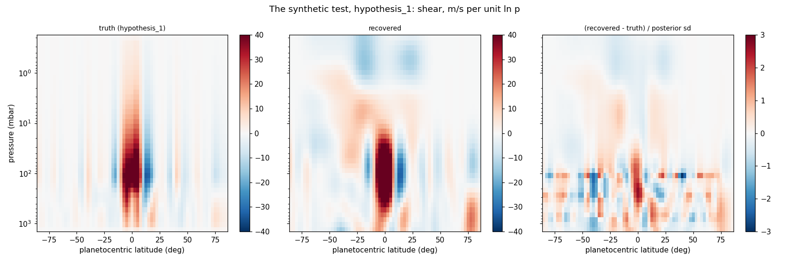
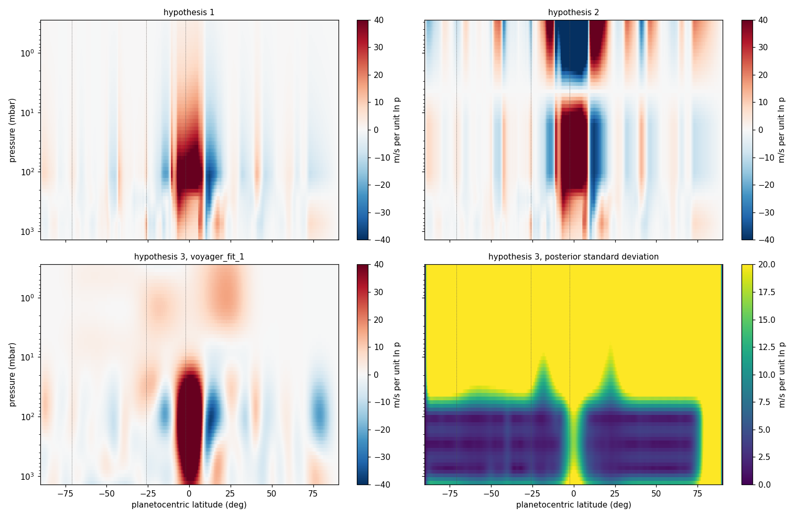
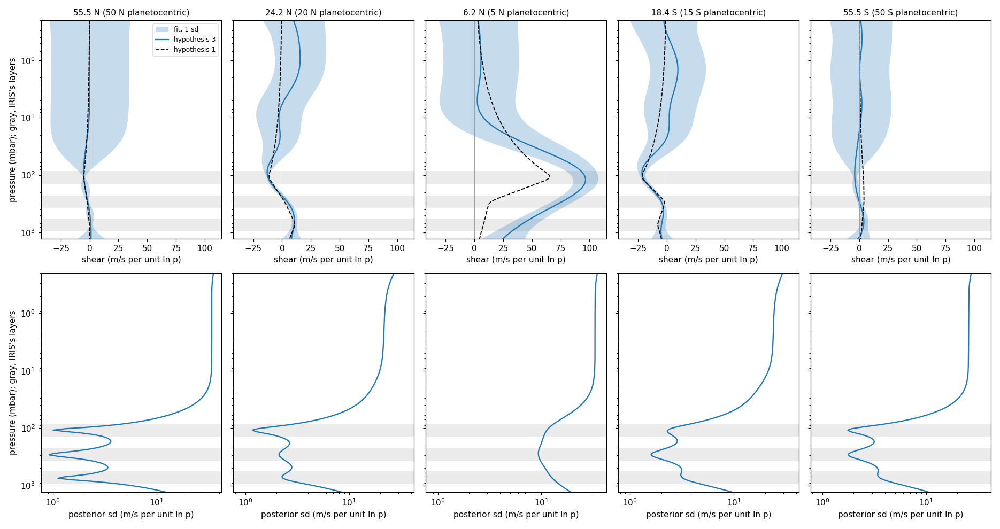
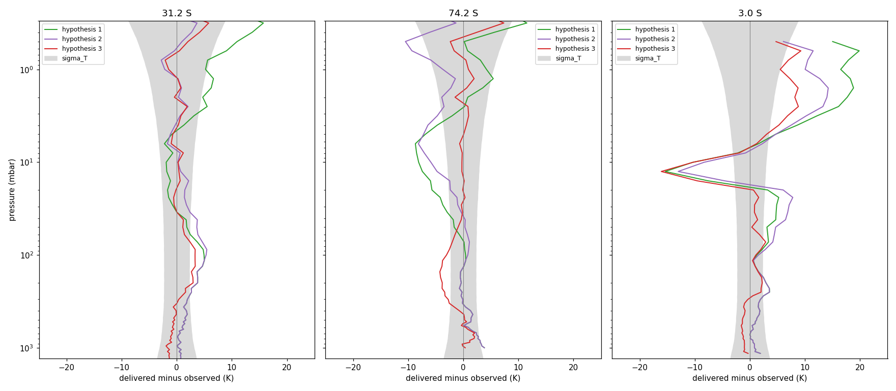
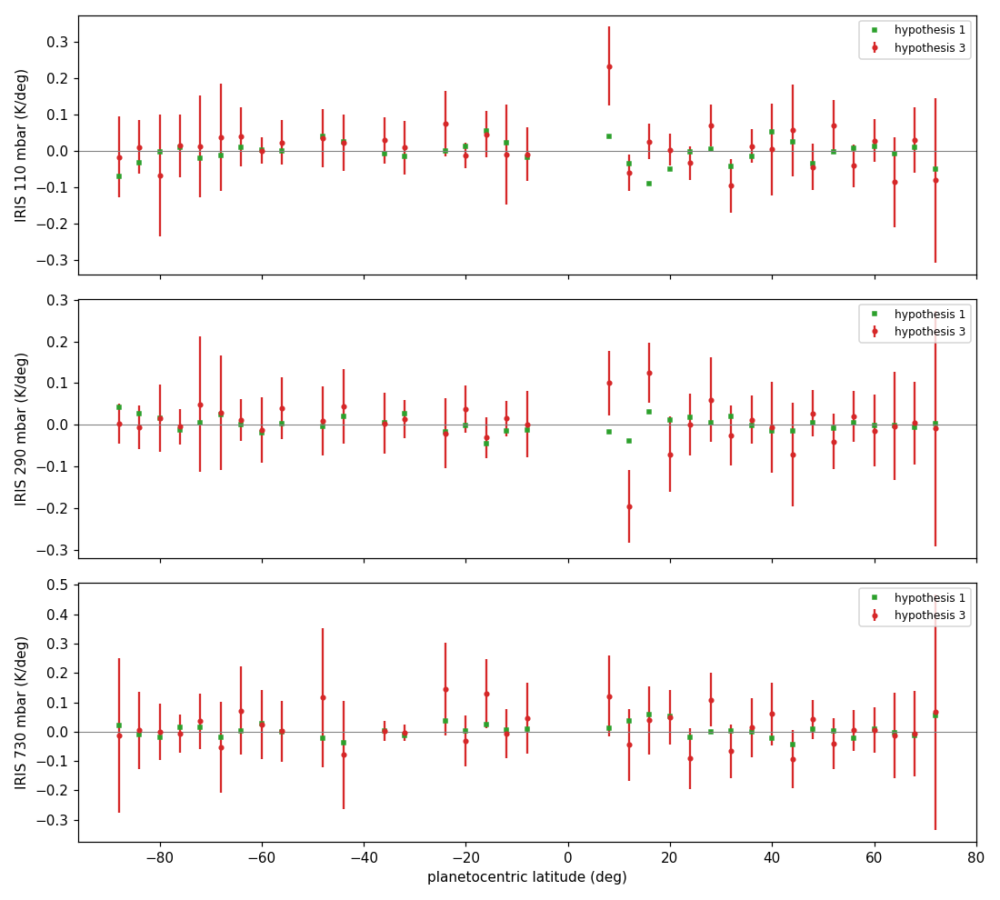

# REPORT 19, Step 1, rerun: the wind fit under the revised budget

SPEC_19 v0.4, Step 1. 6 November 2026. For the author and the reviewing agent. Nothing is committed.
Acceptance: `tests/step19_1/accept_step19_1.py`, output `reports/step19_1/run.log` and `summary.json`.
**3 of 3 bounded checks pass; 5 reported without a bound. The script returns 0.** The first report,
`REPORT_19_step1.md`, stands as the record of the first fit.

Latitudes are planetographic with planetocentric in parentheses, converted as before with the anchor's
ratio of tangents, 1.24. Tables on the fit's own grid are headed planetocentric.

## 1. Result

- **The tool holds up, and the budget's statistics are right on the linear system.** Check 1(b) passes:
  95.6 percent of the shear within 2 sd, every group's mean ratio 0.93 to 1.18.
- **The first fit's failure is gone.** The fit now carries the equatorial jet, and the IRIS ratios fall
  from 9.95, 5.16, 2.89 to 2.32, 1.88, 1.04. At 110 mbar, 31.2 S goes from +6.97 K to +3.34 K and 3.0 S from
  +4.89 K to +0.61 K.
- **I recommend against adopting hypothesis 3 yet, because of the jet.** The fit puts +134.8 m/s per unit
  `ln p` at the equator at 110 mbar, against hypothesis 1's +58.3. IRIS has no row from 9.9 S to 9.9 N (8 S to
  8 N), and the resolution test shows a bias there that the posterior sd does not state: **with no noise at
  all, a truth of +53.9 comes back as +85.0** (§3).
- **The IRIS systematic term is triggered, but I recommend against its sizes as computed.** It needs 2.0 K/deg
  at 110 mbar, 27 times the stated error, because a term smooth in latitude cannot absorb misfit that sits at
  a few rows (§6).
- **The radio's ratios above 1 are mostly the operator, not the data** (§5). That is a measured result in
  one case, new in this report.

## 2. The two items the ruling asks for

**Truths from the amplitude 40 prior go unphysical at 74.2 S.** The first eight truths of the ensemble, each
marched once on a wider wind grid, in K. Hypothesis 1's coldest at 74.2 S is 85.9 K.

| Truth | Coldest | Hottest | Largest change from hypothesis 1 |
|---|---|---|---|
| 0 | 28.2 | 162.6 | 106.6 |
| 1 | 17.0 | 96.6 | 111.3 |
| 2 | 85.8 | 173.0 | 39.8 |
| 3 | 55.1 | 227.3 | 84.7 |
| 4 | 0.7 | 253.9 | 108.8 |
| 5 | refused by the march, even with the grid at 1e-4 Pa | | |
| 6 | 99.6 | 198.2 | 59.3 |
| 7 | 26.5 | 264.8 | 152.2 |

The other two targets' coldest fall to 41.8 to 98.8 K. In scratch fits to these truths, iterates reached
5.6 K and 16 K, and rows came and went (287 to 289), which ended them. The prior's largest sd in delivered T
on the final linearization is 68 K at 74.2 S, 28 K at 31.2 S and 21 K at 3.0 S. Temperature at 74.2 S
integrates the shear along the longest path from the anchor, so it is hit hardest.

**This is a statement about the prior, not about the fit.** The real fit's delivered temperatures at 74.2 S stay
within 4 K of the observed. But amplitude 40 is there to hold the equatorial jet, and it applies everywhere. It
shows in leave-one-out: the prediction of 74.2 S has a stated RMS of 36.9 K, and 46 to 58 K at and above 30 mbar,
so that test has no power there. See §8, point 2.

**The real fit took 12 passes against 3 in the first fit.** From the prior mean it took 8, and agrees within
0.040 K. Largest change in delivered T at each pass of the real fit (K):

| Pass | 1 | 2 | 3 | 4 | 5 | 6 | 7 | 8 | 9 | 10 | 11 | 12 |
|---|---|---|---|---|---|---|---|---|---|---|---|---|
| Step | plain | A | A | A | A | A | plain | A | plain | A | plain | plain |
| 31.2 S | 10.107 | 0.678 | 0.427 | 0.364 | 0.011 | 0.137 | 0.026 | 0.071 | 0.035 | 0.033 | 0.040 | 0.016 |
| 74.2 S | 7.908 | 2.593 | 0.890 | 0.461 | 0.086 | 0.271 | 0.189 | 0.190 | 0.161 | 0.074 | 0.122 | 0.042 |
| 3.0 S | 10.725 | 1.531 | 0.325 | 0.057 | 0.034 | 0.021 | 0.014 | 0.010 | 0.012 | 0.005 | 0.005 | 0.008 |

The first fit's sequence was 9.38, 0.39, 0.03 K. Plain passes alone no longer settle: a diagnostic of six
gave 7.9, 2.54, 1.34, 0.92, 0.24, 0.59 K at 74.2 S (`cycle_diagnostic.log`). **So I changed the iteration,
which goes beyond the spec's text** (§7, item 1). I tested and refuted one cause, IRIS's held `a` term: its
actual minus predicted change is 0.001 sd or less. §5 gives a better lead, not yet tested as the cause.

## 3. Check 1: the synthetic tests

**(b) Statistics, linear: PASS.** 20 truths from the prior, on the final linearization.

| | 31.2 S | 74.2 S | 3.0 S | IRIS 110 | IRIS 290 | IRIS 730 | All |
|---|---|---|---|---|---|---|---|
| Mean ratio | 1.02 | 1.03 | 1.04 | **1.18** | 0.93 | 1.01 | 1.02 |
| Member spread | 0.14 | 0.17 | 0.19 | 0.49 | 0.34 | 0.32 | 0.07 |

Pooled within 1 sd 68.4 percent, within 2 sd 95.6 percent; 92 to 98 percent per member. IRIS 110 is close to
the 1.2 bound, and its sampling error over 20 members is about 0.11, so this pass does not separate 1.18 from
1.2. The seed is fixed and I did not reseed. By construction this test contains no operator error (§5).

**(a) Resolution, hypothesis 1's projection as truth: no bound.** 16 passes from the prior mean. RMS error 5.94
against a true RMS of 8.36 m/s per unit `ln p`; the prior's point sd comes out 33.9 for the amplitude 40. Within
1 sd 94.0 percent, 2 sd 99.4 percent, because this truth is small against the prior. Where the data constrain
it (posterior sd under half the prior's, 37 percent of the grid), within 2 sd 98.5 percent, RMS error 5.24.

**The ratios, and what produces them.** I added two comparisons, and `tests/step19_1/truth_and_noise.py` is new:
the same truth in one linear solve, with no noise, with 1(a)'s noise, and with 20 other noise draws.

| | 31.2 S | 74.2 S | 3.0 S | IRIS 110 | IRIS 290 | IRIS 730 | All |
|---|---|---|---|---|---|---|---|
| 1(a), iterated | **2.46** | **2.06** | 0.80 | **2.42** | 0.68 | 0.33 | 1.50 |
| 1(a)'s noise, one solve | 0.86 | 1.04 | 0.67 | 2.44 | 0.66 | 0.24 | 0.68 |
| 20 other draws, one solve, mean (spread) | 0.96 (0.21) | 1.02 (0.23) | 0.94 (0.14) | 1.37 (0.29) | 0.84 (0.36) | 0.80 (0.33) | 0.74 (0.05) |
| No noise, one solve | 0.01 | 0.01 | 0.01 | 0.75 | 0.08 | 0.10 | 0.11 |

- **IRIS 110's 2.42 is mostly 1(a)'s draw.** It is above all 20 other draws (largest 1.97). This truth's
  structure does raise the mean, to 1.37 against 1.18, which is near one sampling error of the ensemble.
- **The radio's 2.46 and 2.06 come with iterating,** not from the draw: §5.

**The jet: a bias, not noise.** Shear at 110 mbar, planetocentric:

| | 15 | 10 | 5 | 2.5 | 0 | -2.5 | -5 | -10 |
|---|---|---|---|---|---|---|---|---|
| Truth | -32.4 | -13.8 | +64.8 | +66.2 | **+53.9** | +52.2 | +52.0 | +17.4 |
| No noise, one solve | -31.7 | -15.2 | +53.7 | +76.6 | **+85.0** | +80.3 | +64.4 | +12.7 |
| Mean of 20 draws, one solve | -31.7 | -15.4 | +52.8 | +75.2 | **+83.1** | +78.2 | +62.2 | +11.2 |
| Spread of 20 draws | 1.4 | 2.1 | 9.4 | 11.3 | 11.6 | 10.6 | 8.6 | 2.9 |
| 1(a), iterated | -32.4 | -15.8 | +57.4 | +80.6 | **+87.8** | +81.3 | +63.8 | +11.6 |

The estimate piles the jet toward the middle of the IRIS gap, about 30 above the truth at the equator, which
is nearly 3 times the noise spread. That shows in the figure's right panel, at +2 to +3 sd near the equator at
100 to 300 mbar. Iterating does not cause it: 1(a) sits within a few units of the one solve.

This corrects something I said earlier in the session, that the data themselves pull the jet upward. That
reading came from a solve at the real fit's state and should be dropped. I have not traced why the estimate
overshoots rather than shrinks; the bias depends on the truth, so +31 cannot simply be subtracted from the fit.

**Does the basis limit the recovery? Not in 1(a).** Its truth lies on the basis, so this bias comes from the
prior and the data's coverage, and **2.5 deg knots would not be expected to remove it.** The real atmosphere is
another matter. Projecting hypothesis 1 changes the shear by up to 13 at 9.3 N (7.5 N) and 7 at 12.4 N (10 N),
though by under 0.4 K on any path segment. So the basis may still matter at the jet's edge (§6). I also
misnamed a quantity in the first report: "basis limit" is the misfit of hypothesis 1's projection, 2.04, 1.50,
0.58 per row at IRIS, and it is not a limit, since the fit reaches 0.45, 0.40, 0.26 per row on the same basis.

## 4. Check 2: hypothesis 3

Posterior sd of the shear (m/s per unit `ln p`) through IRIS's top:

| mbar | 730 | 290 | 150 | 110 | 90 | 70 | 50 | 30 | 10 | 1 |
|---|---|---|---|---|---|---|---|---|---|---|
| 55.5 N (50 N) | 1.2 | 0.9 | 3.4 | 1.1 | 3.5 | 9.0 | 17.2 | 27.1 | 33.7 | 34.0 |
| 24.2 N (20 N) | 2.3 | 2.1 | 2.3 | 1.2 | 2.3 | 5.2 | 9.2 | 14.0 | 19.8 | 22.1 |
| 6.2 N (5 N) | 12.6 | 9.4 | 10.4 | 11.2 | 12.5 | 15.4 | 20.5 | 27.5 | 32.6 | 32.9 |
| 18.4 S (15 S) | 3.2 | 1.6 | 2.8 | 2.3 | 3.3 | 5.9 | 9.8 | 14.4 | 21.5 | 24.4 |
| 55.5 S (50 S) | 3.6 | 1.8 | 3.0 | 1.8 | 3.2 | 7.1 | 13.1 | 20.5 | 25.4 | 25.7 |

Outside the gap the fit follows hypothesis 1 closely through the IRIS levels, and departs from it only above
IRIS, where the sd is near the prior's. At 6.2 N (5 N) it differs through the whole column, including +96 against
+65 at 110 mbar and, read from the figure, about +60 against about +10 near 500 mbar.

Delivered minus observed (K):

| Target | Hypothesis | 730 | 290 | 110 | 30 | 10 | 4.5 | 1 mbar |
|---|---|---|---|---|---|---|---|---|
| 31.2 S | 1 | +0.40 | +2.32 | +5.00 | -0.51 | -1.90 | +0.10 | +5.24 |
| | 2 | +0.40 | +2.30 | +5.09 | +2.00 | +0.20 | -0.77 | -2.17 |
| | **3** | -0.88 | +0.84 | **+3.34** | -0.28 | +0.26 | -0.27 | -1.46 |
| | first fit | -1.34 | +1.56 | +6.97 | +0.12 | +0.22 | -0.43 | -1.50 |
| 74.2 S | 1 | +2.52 | +0.12 | +0.40 | -3.42 | -8.10 | -6.30 | +4.21 |
| | 2 | +2.52 | +0.11 | +0.50 | -0.74 | -5.88 | -7.26 | -3.70 |
| | **3** | +1.84 | **-2.65** | **-3.58** | -0.18 | -0.24 | -0.13 | +0.93 |
| | first fit | -1.35 | -3.73 | -1.68 | +0.04 | -0.24 | -0.24 | +1.02 |
| 3.0 S | 1 | +0.08 | +2.21 | +0.76 | +4.77 | -10.30 | +6.84 | +16.48 |
| | 2 | +0.08 | +2.20 | +0.84 | +7.00 | -8.27 | +6.32 | +10.04 |
| | **3** | -1.21 | +0.07 | +0.61 | +0.78 | -10.26 | +4.40 | +5.50 |
| | first fit | -0.72 | +2.44 | +4.89 | +1.58 | -11.60 | +4.09 | +7.43 |
| sigma_T | | 2.73 | 2.29 | 2.27 | 2.47 | 2.88 | 3.47 | 5.42 |

- **Better than hypotheses 1 and 2** at most levels at and above 30 mbar, most of all at 74.2 S, and at 31.2 S
  at 290 and 110 mbar.
- **Worse at 74.2 S at 290 and 110 mbar,** which were +0.12 K and +0.40 K under hypothesis 1, now 1.2 and 1.6
  sigma_T.
- **3.0 S at 10 mbar stays about -10 K,** the wave layering that the 15 K term allows.

**At 110 mbar,** delivered minus observed in K, the radio being 0 and sigma_T 2.27:

| Target | Hypothesis 1 | Its projection | IRIS only | Without own radio | Hypothesis 3 | First fit |
|---|---|---|---|---|---|---|
| 31.2 S | +5.00 | +4.98 | +3.11 | +3.70 | **+3.34** | +6.97 |
| 74.2 S | +0.40 | +0.37 | -7.30 | -7.67 | **-3.58** | -1.68 |
| 3.0 S | +0.76 | +0.73 | +0.65 | +0.66 | **+0.61** | +4.89 |

**Where it lands at 31.2 S:** at +3.34 K, or 1.5 sigma_T. It is still not between IRIS and the radio; it lies
0.22 K beyond IRIS alone, on the far side from the radio. The other two targets raise it from +3.11 K to +3.70 K,
and its own radio lowers it to +3.34 K. The radio does move 74.2 S, by 3.7 K. The revision moved the answer at
31.2 S by 3.6 K from the first fit, more than sigma_T.

**The path decomposition at 110 mbar,** K per segment, planetocentric from the anchor:

| | 30.8 to 20 | 20 to 10 | 10 to 5 | 5 to -2.4 | -2.4 to -5 | -5 to -15 | -15 to -26.1 | To 3.0 S | To 31.2 S |
|---|---|---|---|---|---|---|---|---|---|
| Fit minus hypothesis 1 | +0.36 | +0.39 | -0.20 | **-0.99** | +0.71 | -1.33 | -0.61 | -0.45 | -1.68 |
| Projection minus hypothesis 1 | -0.01 | -0.30 | +0.38 | -0.07 | +0.01 | +0.17 | -0.18 | -0.01 | -0.00 |
| Delivered, fit minus hypothesis 1 | | | | | | | | **-0.15** | -1.67 |

The sum reaches the delivered change at 31.2 S, but misses at 3.0 S by 0.30 K. The path to 3.0 S ends in the
segment where the shear changes most, so the held wind's linear weight is probably least exact there; I did not
test that. The first report's sum matched.

| Shear at 110 mbar, planetocentric | 15 | 12.5 | 10 | 7.5 | 5 | 2.5 | 0 | -2.5 | -5 | -7.5 | -10 | -15 |
|---|---|---|---|---|---|---|---|---|---|---|---|---|
| Hypothesis 1 | -30.8 | -36.9 | -20.8 | +42.1 | +65.5 | +63.2 | +58.3 | +53.3 | +51.3 | +37.3 | +25.9 | -21.5 |
| Projection | -32.4 | -33.4 | -13.8 | +29.1 | +64.8 | +66.2 | +53.9 | +52.2 | +52.0 | +39.6 | +17.4 | -20.8 |
| Fit | -33.4 | -37.1 | -17.2 | +36.5 | +96.3 | **+131.2** | **+134.8** | +109.8 | +70.2 | +31.5 | +1.1 | -20.7 |

The first fit flattened this jet to +37.5. It is now a jet, but at more than twice hypothesis 1. Part of that
excess is probably the bias of §3, and how much is not known. The posterior sd at 6.2 N (5 N) is about 11, so the
real fit's +76 at the equator looks highly significant, and I do not think it should be read that way.

**IRIS residuals,** K per deg:

| Level | RMS | Hypothesis 1 | Median stated | Largest three, row's share of the misfit in parentheses |
|---|---|---|---|---|
| 110 mbar | 0.059 | 0.032 | 0.074 | +0.233 at 9.9 N (8 N) (4.6), -0.096 at 37.8 N (32 N) (1.7), +0.069 at 33.4 N (28 N) (1.4) |
| 290 mbar | 0.051 | 0.018 | 0.077 | -0.196 at 14.8 N (12 N) (5.1), +0.126 at 19.6 N (16 N) (3.1), +0.101 at 9.9 N (8 N) (1.7) |
| 730 mbar | 0.062 | 0.025 | 0.104 | +0.109 at 33.4 N (28 N) (1.4), +0.129 at 19.6 S (16 S) (1.2), -0.094 at 50.1 N (44 N) (0.9) |

## 5. Check 3: consistency, and the radio

| Group | Rows | Misfit | Expected | Ratio | Radio modes 21 on: misfit / expected |
|---|---|---|---|---|---|
| 31.2 S | 65 | 71.3 | 58.1 | 1.23 | 69.05 / 44.70 = 1.54 |
| 74.2 S | 60 | 79.6 | 50.7 | 1.57 | 75.91 / 39.41 = 1.93 |
| 3.0 S | 59 | 23.2 | 55.5 | **0.42** | 19.41 / 38.26 = 0.51 |
| IRIS 110 mbar | 35 | 15.6 | 6.7 | **2.32** | |
| IRIS 290 mbar | 35 | 14.0 | 7.4 | **1.88** | |
| IRIS 730 mbar | 35 | 9.2 | 8.9 | 1.04 | |
| All, against S | 289 | 323.8 | 289 | 1.12 | |

Under the Matérn form the ratios can now test the budget, as the review wanted: first fit 0.18, 0.11, 0.21.

**The radio's excess is mostly the operator.** At 1(a)'s one-solve state I marched the model and compared the
actual `h` with the linear prediction:

| | 31.2 S | 74.2 S | 3.0 S | IRIS 110, 290, 730 |
|---|---|---|---|---|
| Misfit with the linear prediction | 50.0 | 52.7 | 37.0 | 16.4, 4.9, 2.1 |
| Misfit with the actual `h` | **101.6** | **94.4** | 41.6 | 16.3, 4.9, 2.2 |
| Operator error alone, weighted | 38.5 | 34.1 | 6.7 | 0.0, 0.0, 0.0 |
| Of it, modes 21 on | 38.5 | 34.0 | 6.6 | |
| Operator error, RMS (K) | 0.13 | 0.34 | 0.23 | |
| The smallest mode's sd (K) | 0.069 | 0.078 | 0.067 | |

That raises the ratios from 0.86, 1.04, 0.67 to about 1.75, 1.86, 0.75, against 1(a)'s iterated 2.46, 2.06,
0.80. **An operator error of 0.1 to 0.3 K, far below sigma_T, counts for as much as the whole noise,** because
the Matérn `R` (condition number 574228) gives its smallest modes an sd near 0.07 K.

- **Measured:** this holds on one pair of states, 1(a)'s. The real fit's own excess is in the same modes.
- **Not established:** whether the rough part is numerical (mesh, interpolation) or real curvature of the
  operator. A remainder at 31.2 S is unexplained.
- **Untested, but the obvious lead:** the same small modes may be why the passes rose from 3 to 12, since each
  solve would be chasing rough parts of `h` weighted that heavily. The first fit's exponential did not weight them so.
- **The fit's state:** at the jet the iteration changes little (§3), so this may mostly hit the statistic, not
  the state. I have tested that only at the jet at 110 mbar.

**3.0 S at 0.42 is low.** The tests expect 0.94 (spread 0.14), and it is low in every mode group. The likely
reading is that the 15 K wave term is larger than the misfit needs. I did not test it.

**The term's trigger,** which the spec asks me to apply: IRIS 110 and 290 above 1.5, and leave-one-out at 74.2 S
at 110 mbar, 2.37 sd.

## 6. The systematic term, reported and not used

Correlated in latitude by a Gaussian, which is my choice of form. Sized per level by one solve, to bring the
group to its expected value:

| Correlation | Size at 110, 290, 730 mbar (K/deg) | Ratios IRIS 110, 290, 730 | Radio ratios | 110 mbar, all data: 31.2 S, 74.2 S, 3.0 S | 110 mbar, IRIS only: 31.2 S, 74.2 S, 3.0 S |
|---|---|---|---|---|---|
| None | | 2.32, 1.88, 1.04 | 1.23, 1.57, 0.42 | +3.34, -3.58, +0.61 | +3.11, -7.30, +0.65 |
| 20 deg | **2.003, 1.267**, 0.045 | 1.03, 1.10, 1.07 | 1.22, 1.56, 0.41 | **+0.60**, -0.06, -1.28 | +11.70, +0.48, +10.88 |
| 40 deg | **17.746, 8.142**, 0.037 | 0.97, 1.06, 1.07 | 1.22, 1.56, 0.42 | **+0.70**, -0.00, -1.25 | +17.70, +1.65, +15.96 |

Scan at fixed multiples of the median stated error, 20 deg:

| Multiple | Ratios IRIS 110, 290, 730 | 110 mbar: 31.2 S, 3.0 S |
|---|---|---|
| 1 | 2.12, 1.74, 0.92 | +3.68, +0.29 |
| 2 | 1.88, 1.57, 0.85 | +3.01, -0.42 |
| 4 | 1.66, 1.42, 0.88 | +2.19, -0.89 |

**These sizes should not be read as IRIS's error.** 2 K/deg is 27 times the stated error, and 18 K/deg is not
credible as an error in a gradient. The term probably grows that far because the misfit is not smooth in latitude.
At 290 mbar, three rows on the jet's northern edge hold 9.9 of the 14.0 misfit, and the edge row at 110 mbar is the
largest there at 4.6 of 15.6. Hypothesis 1 fits those rows well. The levels' RMS residuals remain below the median
stated errors. A term of the full size effectively removes IRIS's large-scale gradient:
the fit then lands on the radio, with IRIS-only predictions of +11 to +18 K. So it would decide the 110 mbar
question by discarding IRIS, not by weighing it.

The scan also shows 4 times the stated error, a size that could be defended, still leaves IRIS 110 at 1.66.

A separate caution on the trigger: 20 draws at hypothesis 1's truth give IRIS 290 a mean of 0.84 (spread 0.36) and
IRIS 110 a mean of 1.37 (0.29), largest 1.97. The real 1.88 and 2.32 are above those, so **the excess looks real,
but it is located at the jet's edge rather than spread in latitude.** One of 21 draws at IRIS 110 did reach 2.44.

## 7. Checks 4 to 6, and the departures

**Leave-one-out,** weighted error over rows (1 if the stated errors and the prior are right):

| Withheld | Weighted | RMS error | RMS stated | Observed minus predicted (stated) at 730, 290, 110 mbar, K |
|---|---|---|---|---|
| 31.2 S | 1.55 | 3.85 K | 11.48 K | +0.0 (3.3), -2.2 (2.7), -4.7 (2.7) |
| 74.2 S | 2.00 | 5.14 K | 36.86 K | -1.9 (4.7), +6.2 (3.4), **+9.1 (3.8)** |
| 3.0 S | 0.93 | 6.35 K | 11.83 K | -0.9 (3.3), -1.6 (2.7), -1.1 (2.8) |
| IRIS 110 mbar | 1.13 | 0.294 K/deg | 1.214 K/deg | |
| IRIS 290 mbar | 0.74 | 0.135 K/deg | 0.894 K/deg | |
| IRIS 730 mbar | 1.27 | 1.595 K/deg | 1.164 K/deg | |

These predictions include the shared anchor term's correlation with the other targets. The "without own radio"
column of §4 does not, which is why 74.2 S reads 9.1 here and 7.67 there. Withheld, IRIS is predicted far less
precisely than its stated errors, as expected: the radio does not locate gradients row by row.

**The solve.** §2 for the passes. Pressure identity largest 1.84e-3, 2.75e-3, 2.45e-3. Registered runs reproduce
the fit's last runs exactly. The start from the prior mean: 8 passes, within 0.009, 0.040, 0.002 K (bound 0.1 K).
`casspian-wind-fit` itself against the same fit in the script: wind difference 0.

**The wind aloft.** Poles zero and reference level unchanged. The largest change from the base wind is 206.9 m/s
at 0.6 N (0.5 N), 14.13 mbar, posterior sd 55.8 m/s. By level:

| mbar | Largest change (m/s) | At, planetocentric | Its sd | Change over sd | RMS change | Median sd |
|---|---|---|---|---|---|---|
| 730 | 41.1 | 1.0 | 10.0 | 4.1 | 8.0 | 1.6 |
| 290 | 32.7 | 1.0 | 5.6 | 5.8 | 6.4 | 0.6 |
| 110 | 119.3 | 1.0 | 19.1 | 6.3 | 23.4 | 2.2 |
| 30 | 195.6 | 1.0 | 38.2 | 5.1 | 39.0 | 13.8 |
| 10 | 205.3 | 0.5 | 63.3 | 3.2 | 41.1 | 43.2 |
| 4.5 | 197.3 | 0.5 | 79.5 | 2.5 | 39.5 | 61.1 |
| 1 | 189.3 | 0.5 | 104.2 | 1.8 | 39.6 | 86.8 |

All within about 1 deg of the equator, the jet again; a change of 6 sd there carries §3's caveat. The layer
operator at hypothesis 1's wind returns the data to RMS 0.0219, 0.0111, 0.0121 per radian against a median error
near 0.05. These are about double the first report's point operator, since hypothesis 1 solved at a point.

**Departures and choices for the reviewer:**
1. **The iteration, beyond the spec's text.** `driver.iterate` now takes an Anderson(1) step after the first pass
   while the solve's linear change is at or above 0.1 K. Only a plain step under 0.1 K ends it, and the fit
   returned is that plain solve. The plain-only rule is needed: pass 5 above reads 0.086 K and pass 6 reads 0.271 K.
   `max_passes` is 20, was 8. The same fixed point is reached from two starts, which is the evidence it does no harm.
2. **The term's Gaussian form,** §6.
3. **First guess** as ruled: the projection of hypothesis 1, with the check from the prior mean.
4. **`tests/step19_1/survey_truths.py` holds §2's survey.** The log `reports/step19_1/truth_survey.log` comes from
   the scratch version of the same survey, which did not include the grid comparison the file runs first. That
   comparison was run separately on hypothesis 1's projection: differences 0.0 in T, `h` and `H`. The file as
   committed has not been run.
5. **`tests/step19_1/truth_and_noise.py` holds §3's and §5's new numbers.** It was run as a scratch copy; the
   filed version adds only the removal of its work directory afterward. Log `reports/step19_1/truth_and_noise.log`.
6. **Beyond the spec:** "1a, continued" in the acceptance, the prior's sd in T under 1(b), the radio modes.
7. **Check 1(b)'s record** comes after the fit in the log, since it needs the final linearization.
8. **Products** are stamped `-dirty` and need rebuilding at the acceptance commit.

## 8. For the author

Each mine to recommend and yours to rule:

1. **Hypothesis 3: not adopted yet.** Its jet carries a bias the stated uncertainty leaves out, and how much of the
   +134.8 is bias is unknown. Outside the IRIS gap I see no objection from these checks.
2. **Amplitude 40 only where it is needed.** I recommend 40 within about the jet and something smaller elsewhere,
   sized to keep 74.2 S physical. This also restores leave-one-out's power at 74.2 S. It is a budget change, and I
   have not tested it. The same run shows whether the jet's bias depends on the prior.
3. **The jet's bias needs its own look before any refit.** I recommend varying the truth's jet in the linear system,
   about 5 minutes per linearization, to learn how the estimate maps a jet into the gap. That is what would let the
   +134.8 be read, and no new data type is required. I would do this next if you agree.
4. **The systematic term: not at these sizes.** If one is wanted, a term local to the jet's edge is closer to what
   the residuals show than a term smooth in latitude. 2.5 deg knots are the cheaper test of whether the edge rows
   are a basis limit, and by §3 they test that only, not the jet's overshoot.
5. **The operator's error in the radio budget.** An uncorrelated term near 0.1 to 0.3 K, a floor under `R`'s small
   modes, would represent it. It may also bring the passes down. Untested on both counts. The alternative is to
   find and remove the roughness in the operator.
6. **3.0 S's 15 K term,** which the 0.42 suggests is large. Lower priority.
7. **The iteration's change** (§7, item 1), and `max_passes = 20`.

No model change is needed, and no regression is due. Check 1(b) passes as ruled; whether Step 1 is accepted with
hypothesis 3 not adopted, as the tool was, or stays open for a further refit, is yours.
