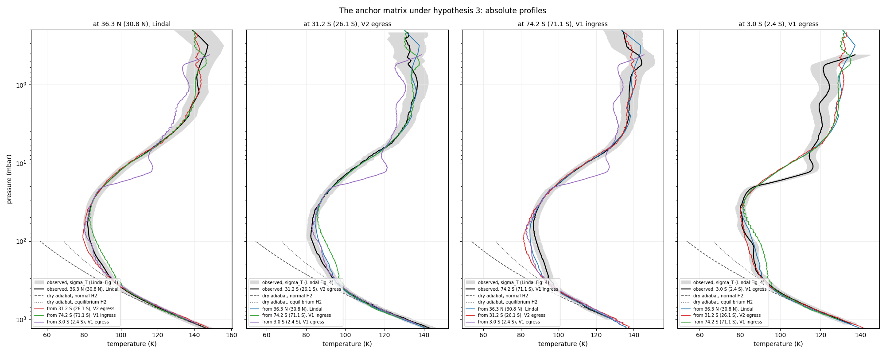
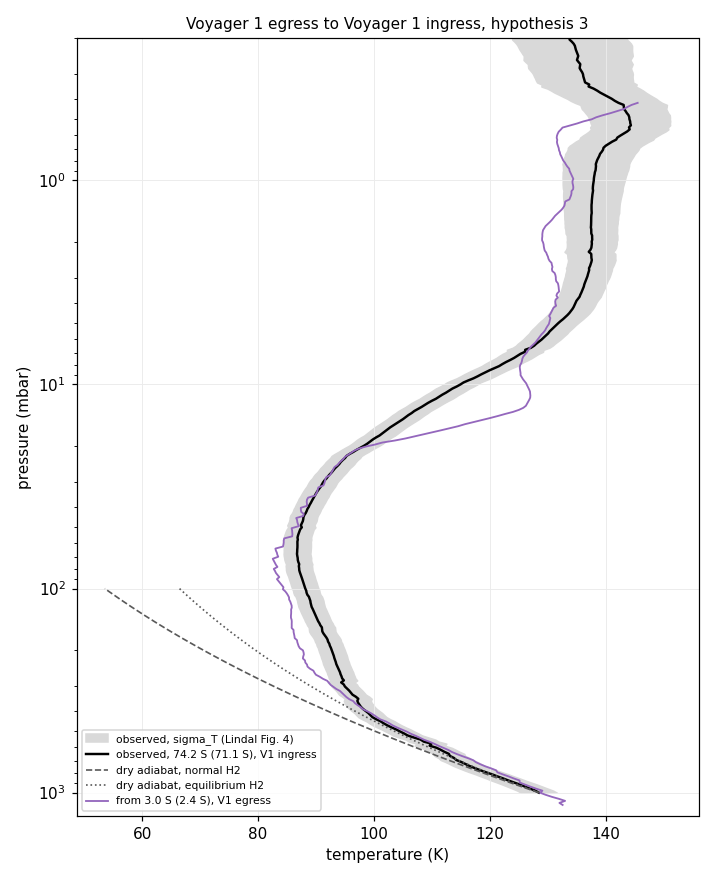
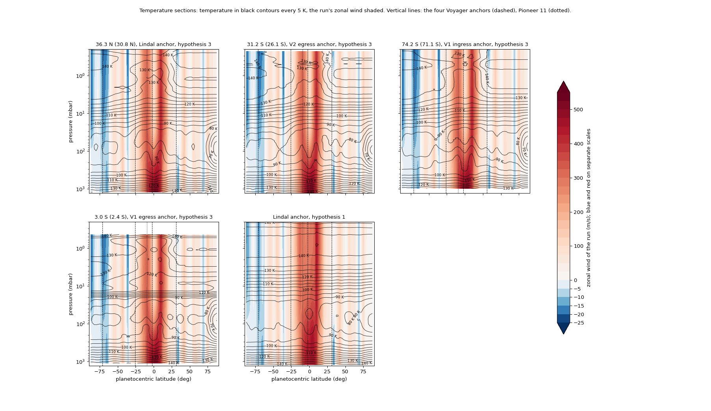
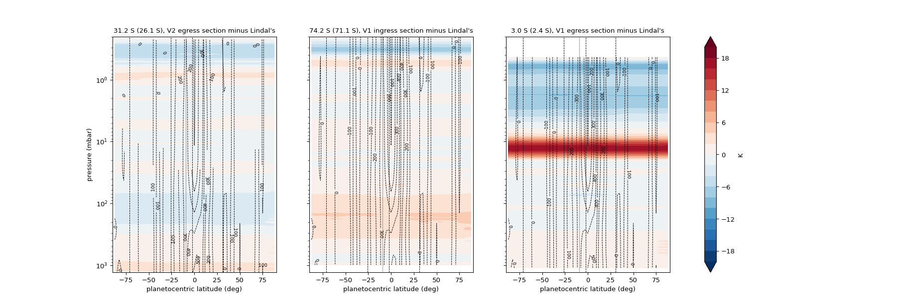
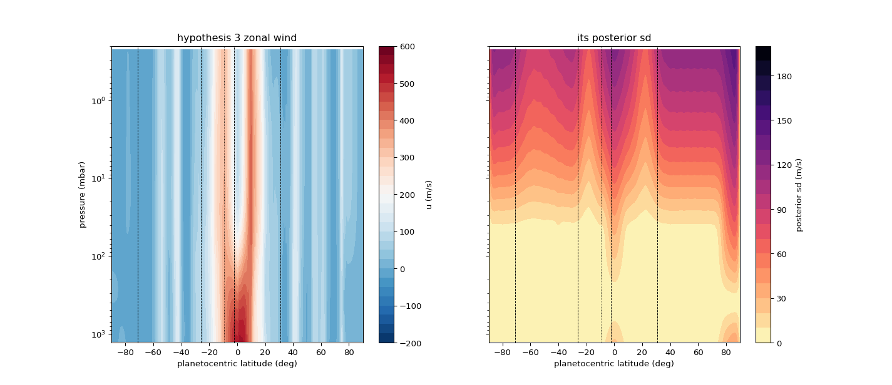
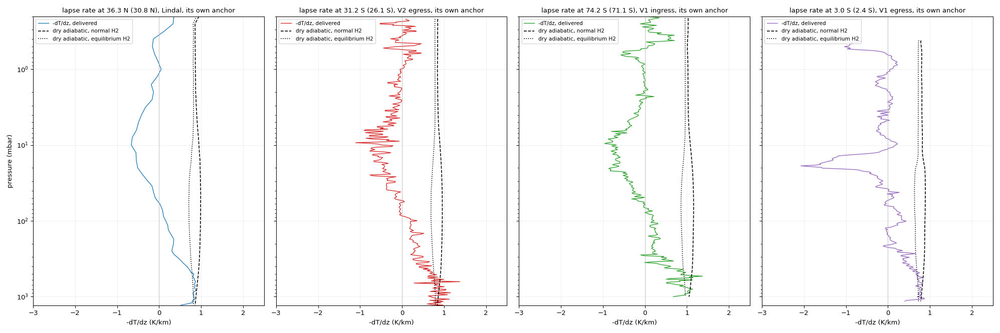
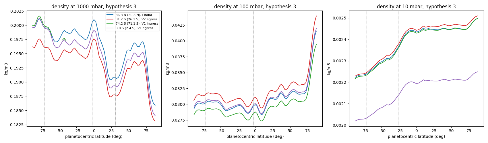

# REPORT 20, Step 1: sections, and the Voyager profiles as anchors

SPEC_20 v0.4, Step 1. 9 November 2026. For the author and the reviewing agent. **Nothing is committed.**
Acceptance: `tests/step20_1/accept_step20_1.py`, output `reports/step20_1/run.log` and `summary.json`.
**3 of 3 bounded checks pass; one reported without a bound. The script returns 0.** One item of v0.4 is not
done: the reference adiabat, which the model has nothing to draw from (§5 item 1).

Latitudes are planetographic with planetocentric in parentheses: Lindal 36.3 N (30.8 N), Voyager 2 egress
31.2 S (26.1 S), Voyager 1 ingress 74.2 S (71.1 S), Voyager 1 egress 3.0 S (2.4 S).

## 1. Result

- **The three anchors are built by the existing chain, and no shared tool or model code changed.** Lindal's
  files are byte-identical. Each new anchor closes on its own profile within the tracing's precision.
- **The section tool reproduces SPEC_19's single runs to 6.4e-3 K,** against acceptance 3's 0.1 K.
- **The anchors agree to within about sigma_T below 30 mbar, with one exception.** The two southern profiles
  disagree at 110 mbar by 6.5 to 6.8 K, about 3 sigma_T. Lindal's anchor sits between them.
- **Above 30 mbar, the Voyager 1 egress anchor carries its 10 mbar inversion everywhere,** as SPEC_20 §3 note 2
  expected: about +11.5 K at 10 mbar at every other profile.
- **Voyager 1 egress to Voyager 1 ingress,** the same occultation hours apart: within 1.6 sigma_T from 730 to
  30 mbar, then the inversion.
- **Two findings for the status note,** neither a fault in this step: SPEC_15's Voyager 2 egress pressures
  carry gravity 0.41 percent low (§3.2), and hypothesis 3 cools the north pole 12 K below hypothesis 1 (§4.3).

## 2. What was built

| Item | Where |
|---|---|
| Ingest, stages one and two | `src/casspian/tools/lindal/build_profile_raw.py`; commands `casspian-voyager-raw`, `casspian-voyager-inputs` |
| Scalars transcriptions, with epochs and Lindal's reliability notes in comments | `occul_data/lindal/raw/{voyager2_egress,voyager1_ingress,voyager1_egress}_scalars.toml` |
| Build files | `occul_data/lindal/<prefix>_build.toml` |
| Kinds raw, C, T, D, manifest, N | `occul_data/lindal/<prefix>_*`, beside Lindal's |
| Closure runs | `forward/<prefix>_closure/`, copies of `lindal_closure` with the name, date, anchor and raw bundle changed |
| Section tool | `src/casspian/tools/section/section.py`; command `casspian-section` |
| Sections | `sections/<anchor>_<wind>/<name>.toml`, product `<name>_section.nc` (ignored) |
| Anchor matrix | `forward/<anchor>_to_<36n,31s,74s,03s>/`, nine runs by `tests/step20_1/build_matrix.py` |
| Acceptance, figures | `tests/step20_1/accept_step20_1.py`; `reports/figures/step20_1_*.png` |

**Departures and choices for the reviewer:**
1. **A transfer's composition must be on its anchor's levels.** `forward.transfer.place` produces the anchor
   unlabeled on the composition's own levels, as a closure does. The SPEC_19 runs' composition is on Lindal's 66
   levels, so the new anchors' runs and sections each take the same mixture on their own levels: 94/6 with
   Lindal's ammonia (ruling 2). For the matrix runs it is built from the anchor's raw bundle; for the sections it
   is the anchor's own kind C, named by a `composition` key in the control file. No model change.
2. **The datum isobar is 100 mbar** in the Voyager 1 ingress runs and in every section's marches. That trace
   stops at exactly 1000 mbar, so 1 bar is not a produced level and the run refuses. The datum places only the
   altitude: no temperature, pressure or density moves. Each change has a comment.
3. **Season (ruling 3).** The shared tools require the four season keys. Each Voyager 1 file states its true
   date, 13 November 1980, and reuses Lindal's Ls 18.2 with a source line saying so. No key was added.
4. **Lindal's ammonia** is carried onto each profile's levels inside his tabulated span (831.8 to 1258.9 mbar),
   linear in pressure. Kind C's own rule fills the rest, as for his levels. Kind C labels those carried values
   `measured`; they are interpolated from his.
5. **The Voyager 2 egress** gets a 100 mbar level, linear in `ln p` (100.282 and 103.332 mbar either side), and
   its rows reversed to increasing pressure. Its heights are Lindal's altitudes, as traced.
6. **The section's mesh** carries every section latitude as an exact node (`outer_loop(mesh=...)`), so each is
   produced by `produce_at_target` itself. One march per side of the anchor, toward 87.5 N and 87.5 S.
7. **"192.1 E"** in the Voyager 1 egress comment is read from text extraction of the PDF, which prints it as
   "192. Io". It is a comment, not a value.

## 3. Checks 1 to 3

**1. Lindal's answer: PASS.** No tracked file under `occul_data/lindal`, `forward/lindal_closure` or
`forward/lindal_transfer` differs; 24 new files sit beside them. I also hashed Lindal's 12 registered files before the build
and checked them after: identical.

**2. Closures: PASS** (bound 1 K, the tracing's precision: SPEC_15's calibration traces have RMS 0.95 and 1.51 K).

| Anchor | Levels | Largest dT (K) | RMS dT (K) | Largest dp/p |
|---|---|---|---|---|
| Lindal, for scale | 66 | 0.48 | 0.13 | 3.3e-3 |
| Voyager 2 egress | 392 | 0.60 | 0.42 | 4.1e-3 |
| Voyager 1 ingress | 385 | 0.0036 | 0.0017 | 2.5e-5 |
| Voyager 1 egress | 345 | 0.0035 | 0.0018 | 2.9e-5 |

The Voyager 1 closures are near exact because their heights are hydrostatic in the model's own terms (ruling 1),
so they test the chain, not the data. **The Voyager 2 egress's 0.6 K has a cause** (§3.2).

### 3.2 A finding: SPEC_15's egress pressures carry gravity 0.41 percent low

- **The pattern:** the egress closure's `dp/p` rises over the top millibar and is a constant +4.1e-3 from 1 mbar
  down. That is a constant 0.4 percent in `m g / R T` between SPEC_15's integration and the model's.
- **The cause:** SPEC_15's `egress_profile.to_pressure` evaluates gravity at Lindal's 1 bar **ellipse**,
  58,978.7 km at 26.1 S. The model's wind geoid puts 1 bar about 100 km lower there, so SPEC_15's `g` is 0.41
  percent low. I checked by rerunning `to_pressure` (it reproduces the CSV to 2e-5) and comparing its `g` with
  the model's at the same point: ratio 0.99587. Its match to `1/cos psi` (4.04e-3) is a coincidence.
- **The effect:** pressures off by up to 2.8 percent near 1 mbar, about 0.3 to 0.5 K in temperature at a given
  pressure, under sigma_T. The same CSV is SPEC_19's 31.2 S target.
- **Below materiality** (author, 9 November), so I changed nothing. If wanted, the fix is one line in
  `to_pressure`: gravity at the geoid radius. It would rebuild the CSV and move SPEC_19's 31.2 S target data by
  about this much.

**3. The section against single runs: PASS.**

| Run | Largest section minus run | RMS |
|---|---|---|
| `lindal_voyager_fit_1` (31.2 S) | 4.6e-3 K | 3.4e-3 K |
| `lindal_voyager_fit_1_74s` | 1.9e-3 K | 1.2e-3 K |
| `lindal_voyager_fit_1_03s` | 6.4e-3 K | 3.9e-3 K |

The residue is the two meshes: a section's march reaches 87.5 deg; a run's ends at its target.

## 4. For the author, absolute first

### 4.1 The anchor matrix under hypothesis 3

Delivered minus observed (K); the band is Lindal's Fig. 4 sigma_T:

| At | From | 730 | 290 | 110 | 30 | 10 | 1 mbar |
|---|---|---|---|---|---|---|---|
| 36.3 N | V2 egress | +1.53 | -0.20 | -3.11 | +0.53 | +0.60 | +2.30 |
| | V1 ingress | -1.14 | +2.77 | +3.38 | -0.06 | +0.34 | -0.93 |
| | V1 egress | +1.38 | +0.59 | -0.14 | +0.15 | **+11.63** | -4.65 |
| 31.2 S | Lindal | -1.41 | +0.75 | +3.33 | -0.27 | +0.23 | -1.47 |
| | V1 ingress | -2.29 | +3.31 | **+6.80** | -0.14 | +0.47 | -2.48 |
| | V1 egress | +0.20 | +1.11 | +3.30 | +0.08 | **+11.72** | -6.28 |
| 74.2 S | Lindal | +0.92 | -2.71 | -3.58 | -0.17 | -0.23 | +0.94 |
| | V2 egress | +2.64 | -3.00 | **-6.45** | +0.60 | +0.46 | +3.40 |
| | V1 egress | +2.51 | -2.21 | -3.47 | +0.23 | **+11.45** | -3.64 |
| 3.0 S | Lindal | -1.44 | +0.03 | +0.61 | +0.66 | -10.46 | +5.51 |
| | V2 egress | +0.26 | -0.42 | -2.34 | +1.26 | -9.82 | +7.67 |
| | V1 ingress | -2.33 | +2.55 | +4.05 | +0.69 | -10.24 | +4.50 |
| sigma_T | | 2.73 | 2.29 | 2.27 | 2.47 | 2.88 | 5.42 |

- **110 mbar is where the anchors disagree,** as in SPEC_19. The two southern profiles miss each other by 6.5 to
  6.8 K, about 3 sigma_T. Lindal's anchor misses each by about half that, so hypothesis 3, fitted to Lindal's
  transfers, leaves the disagreement split between them (SPEC_20 §3 note 1).
- **The 10 mbar column** is the Voyager 1 egress inversion, carried out (+11.5) or missed when arriving (-10).
- **Above 1 mbar**, differences reach 5 to 8 K against a 5.4 K sigma_T, mostly to and from 3.0 S.

**Voyager 1 egress to Voyager 1 ingress,** the case wanted on its own:

+2.51, -2.21, -3.47, +0.23, +11.45, -3.64 K at 730, 290, 110, 30, 10 and 1 mbar. It is about as close as Lindal's
own transfer to 74.2 S below 30 mbar (+0.92, -2.71, -3.58, -0.17), with no Lindal anchor and no nine months.
Above 30 mbar it is the inversion.

### 4.2 The sections

Same color scale throughout. Dots are IRIS's points in the same colors; dashed lines are the four anchors and
dotted is Pioneer 11. The hatching is `voyager_fit_1`'s posterior sd of the shear over half the prior's, from one
linearization at the fit. It covers almost everything above about 50 mbar and the equatorial band, as SPEC_19
found.

Mean and largest |difference| from Lindal's section (K):

| Anchor | 1300 to 200 mbar | 200 to 30 mbar | 30 to 0.2 mbar |
|---|---|---|---|
| V2 egress | 1.4, 3.0 | 1.9, 3.5 | 1.3, 5.8 |
| V1 ingress | 1.6, 4.3 | 2.2, 5.3 | 1.1, 7.2 |
| V1 egress | 1.4, 2.8 | 0.8, 2.2 | **5.9, 17.8** |

The differences are nearly uniform in latitude. Each anchor's offset from Lindal's travels with it, because one
wind carries both.

### 4.3 Wind, lapse rate, density

- **The lapse rate is drawn without the adiabat** (§5 item 1).
- **Deep:** below 500 mbar the median lapse rate is 0.85 to 0.89 K/km in every section. Lindal's statement
  (0.8 K/km, 6 percent below the adiabat) puts his adiabat near 0.85 K/km.
- **The largest values** below 500 mbar, 1.5 to 2.6 K/km, all sit at the north limit, 87.5 N. The Voyager 2
  egress and Voyager 1 ingress sections are also noisy level to level, 1.37 to 1.38 K/km at their own latitudes.
  That is the tracing differenced on 1 km levels. I do not read either as superadiabatic.

Density follows the temperature offsets. The Voyager 1 ingress line is missing at 1000 mbar except where its
bottom reaches it.

**A finding at the north pole:**
- **The values:** under hypothesis 3, 110 mbar cools from 81 K at 70 N to 62.8 K at 87.5 N. Under hypothesis 1
  it reaches 74.4 K.
- **Where:** this is poleward of IRIS's last row (72 N planetocentric), under the cloud wind's 103 m/s jet at 75 N.
- **Not unconstrained:** the hatching says the fit's shear there is not left to the prior.
- **Why it is only a finding:** it is a feature of hypothesis 3 away from the radio data. Per SPEC_20 §3 note 4
  it goes to the status note, not to a change.

**Fig. 9, the check of ruling 1.** Each anchor's 100 mbar altitude above Lindal's reference geoid, against his
nearest point:

| Anchor | Ours | Fig. 9 | Difference |
|---|---|---|---|
| Lindal | 61.8 | 61.0 | +0.8 km |
| V2 egress | 64.0 | 59.7 | +4.3 km |
| V1 ingress | 14.6 | 13.3 | +1.3 km |
| V1 egress | 121.9 | 121.3 | +0.6 km |

These are within or at Lindal's 3 to 4 km geoid fit. The Voyager 1 radii are kind D's by construction, so this
checks the geoid, not the heights.

## 5. For the author

1. **The adiabat (v0.4) needs a source of `c_p`.** The model carries no heat capacity in its code or in
   `data_static`, so there is no `c_p` "as the model takes it", and no ortho to para state. Two ways, yours to
   rule:
   - **(a) recommended:** a heat capacity table in `data_static` for H2 (normal and equilibrium) and He against
     temperature, from a cited source. Each panel then gets its adiabat, labeled normal or equilibrium. That is
     new data, not new physics, but it is a value the model has never held.
   - **(b)** draw only Lindal's 0.85 K/km near 1 bar as a reference. It needs no data, but it is not "the run's
     own composition and thermodynamics".
2. **SPEC_15's egress gravity (§3.2):** below materiality. A comment, or the one-line fix with the CSV and
   SPEC_19's target data rebuilt.
3. **The departures of §2,** chiefly items 1 and 2.
4. **The north polar cooling (§4.3)** for the status note.

No regression is due: no model or shared tool changed (`pyproject.toml` gains three commands, and `.gitignore`
ignores the sections' products and work directories). The products are stamped `-dirty`. At acceptance they
rebuild clean: the anchors by their build files, the closures and matrix runs by `casspian-run-inputs` and
`casspian-forward`, the sections by `casspian-section`.

## 6. At the acceptance commit (REVIEW_20_step1)

**The adiabats (ruling 1).** `src/casspian/lib/heat_capacity.py` forms the mixture's molar `c_p(T)` from each
run's kind C.
- **H2:** `5/2 R` of translation plus rotation from its rotational partition function on rigid rotor levels.
  The rotational temperature is 85.35 K, from B_0 = 59.322 cm^-1 (Huber and Herzberg). It is stated from the
  reference, not read from its page here. H2 is computed both normal (ortho to para 3:1, frozen) and equilibrium.
- **He:** `5/2 R`.
- **NH3:** a classical nonlinear rigid rotor, `4 R`.

The constants are in a new `data_static/heat_capacity.toml`. `species_master.toml` is untouched, because Lindal's
kind C hashes it. As checks, normal H2 has `c_p/R` 3.46 at 300 K. At 1.3 bar and 145 K the mixture's dry lapse
rate is 0.895 K/km normal and 0.85 K/km equilibrium.

Both adiabats are drawn, labeled, on every temperature panel, from the observed profile's deepest point up to
100 mbar.

The lapse-rate figure is now each anchor's lapse rate at its own latitude, against both dry adiabatic lapse rates
`g m_bar / c_p`, with `g = -(dp/dz)/rho` from the section. Below 500 mbar:

| Anchor | Median | Normal adiabat | Levels over it, largest excess | Equilibrium adiabat | Levels over it |
|---|---|---|---|---|---|
| Lindal | 0.832 | 0.895 | 0 of 22, -0.011 | 0.809 | 17 of 22 |
| V2 egress | 0.810 | 0.876 | 15 of 49, +0.479 | 0.789 | 29 of 49 |
| V1 ingress | 0.936 | 1.087 | 5 of 31, +0.262 | 0.948 | 14 of 31 |
| V1 egress | 0.750 | 0.815 | 4 of 37, +0.079 | 0.719 | 27 of 37 |

- **Lindal's deep lapse rate is 7 percent below our normal adiabat.** Lindal states 6 percent: the heat
  capacity agrees with his.
- **Every deep profile lies between the two adiabats or near the normal one.** The levels over the normal
  adiabat are in the traced profiles, which are differenced on 1 km levels: single levels, not a layer. I do not
  read them as superadiabatic.

**The rebuilt egress (ruling 2).** `egress_profile.to_pressure` now takes `r_1bar` from the wind geoid through
kind D's 1 bar surface, marched as the reduction marches its own.
- **The trace is unchanged:** `voyager2_egress.csv` keeps its altitudes and temperatures exactly.
- **The pressures move:** by +0.11 percent at 1300 mbar, -0.96 percent at 100 mbar and -3.5 percent at the top.
- **The anchor's closure** is now 0.012 K at most (RMS 0.007 K), with `dp/p` 8.6e-5 at most, against 0.60 K and
  4.1e-3 before.
- **SPEC_19 is not refitted** (ruling 2). The next fit reads the corrected file.

**The section figures (ruling 4)** carry each run's zonal wind as dashed contours labeled in m/s, and no shear
hatching. The acceptance no longer linearizes `voyager_fit_1`.
